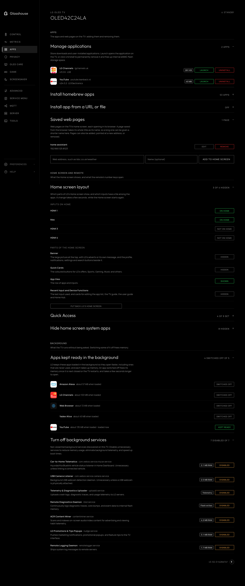

# Apps and home screen launcher

The **Apps** tab, `/?tab=apps`, installs and removes apps, tidies the Home screen, and frees the memory LG's background services and apps take up.

*Installed applications, background services, apps kept ready in the background and saved web pages.*

## Install homebrew apps

Lists the Homebrew Channel catalog, with Install, Update or Uninstall for each app. Downloads are checked against the catalog before they are installed, and the dashboard asks first when something needs a decision, such as replacing a copy installed from the LG store.

## Uninstall applications

Lists the apps downloaded from the LG store or installed by hand, with their version and vendor. Uninstall deletes an app completely and frees its storage. LG's built-in apps can't be removed this way; they can be hidden instead.

## Quick Access

Sets what each number key on the remote opens when it is held: an installed app, an HDMI input or Live TV, for keys 1 to 9. Holding 0 shows the list on the TV. A change applies straight away, the same as changing it in the TV's own Quick Access list, which shows it too.

**None** leaves a key opening nothing, including one LG set itself, such as its help on 9. A key LG set for an app that is not installed, as it does for some regions' channel apps, shows as **App not installed**, with the app's id beneath. A key set to a live TV channel on the TV shows the channel, and can be changed here but not set to another channel. The TV app lists the keys without changing them.

## Hide home screen system apps

Hides built-in LG apps that can't be uninstalled, such as Gallery, Music, Sports, Alexa and the User Guide, from the Home screen ribbon. The apps themselves stay on the TV, and switching the feature off brings every one back.

It is experimental, and off until it is turned on under **Server** → **Advanced** → **Experimental features**; see [Experimental features](../experimental.md) for why. It is not offered on a Homebrew Channel install.

## Turn off background services

Stops background services that most TVs don't need, such as the connected-car listener, the USB camera watcher, and LG's diagnostics and telemetry uploaders. Only the services present on the TV are listed. A service switched off stays off across restarts, and is stopped again if something on the TV starts it.

## Apps kept ready in the background

LG keeps some apps loaded so they open faster, including ones that are never used, and each takes up memory. The list shows each one with roughly how much memory it takes once loaded, and which are loaded now.

Switching an app off frees its memory once the app is next closed or the TV restarts, and it then takes a few seconds longer to open. Switching it back on returns it to LG's setting. Home, Live TV, the HDMI inputs and the other parts the TV relies on are not listed, and the section only appears on TVs that keep such a list.

## Saved web pages

Lists the web pages on the Home screen, each of which opens in the TV's browser. A page saved from the browser takes its whole title as its name, so a long one can be given a shorter name here. Pages can also be added, pointed at a new address, or removed.

## Install app from a URL or file

Installs an `.ipk` package from outside the catalog. **From URL...** downloads one from an http or https address, with an optional sha256 to check it against, and **Upload .ipk** sends one from the browser. Both show the same preview as a catalog install.

It is off until it is switched on in this section (after a warning) or a token is set, since a package from outside the catalog can run anything on the TV. A request from the TV itself is always allowed.

## Notes

* Live TV, Settings, Home, the HDMI inputs, the Homebrew Channel and Glasshouse itself are protected: they can't be hidden or uninstalled.
* Everything on this tab also works from the TV app, except saved web pages and installing from a URL or a file, which are in the browser dashboard only.
* Apps that check they were installed from the LG store may refuse to run when installed another way, and apps built for a newer webOS than the TV runs may not launch.
