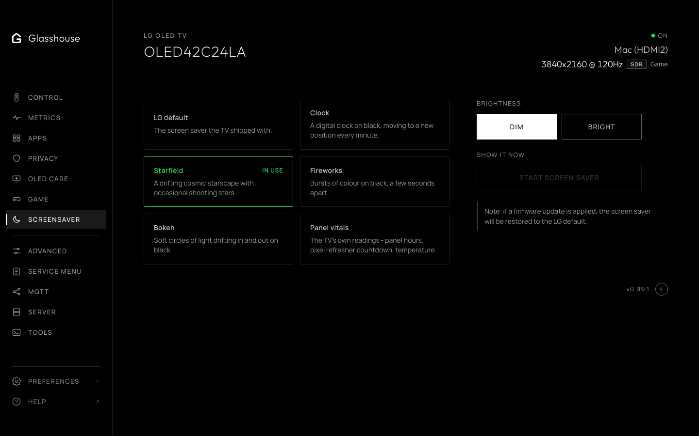

# Screen savers

The **Screensaver** tab, `/?tab=screensaver`, provides six alternatives to LG's default:

* Clock
* Starfield
* Fireworks
* Bokeh, soft circles of light drifting in and out
* Harmonograph, pendulum ribbons of light weaving and fading on black
* Panel vitals, showing the TV's own panel hours and refresher countdown

Each mode offers dim and bright variants, and visual elements continuously drift across the screen to prevent OLED burn-in or image retention.

A firmware update restores the LG default.

On webOS 10 and later they are experimental: the tab shows a switch above the list that turns them on, after a warning, and until then only LG's default can be chosen. See [Experimental features](../experimental.md) for why.

*Built-in screen saver choices, including the panel-vitals display.*

*The Starfield screen saver with continuously moving elements.*
