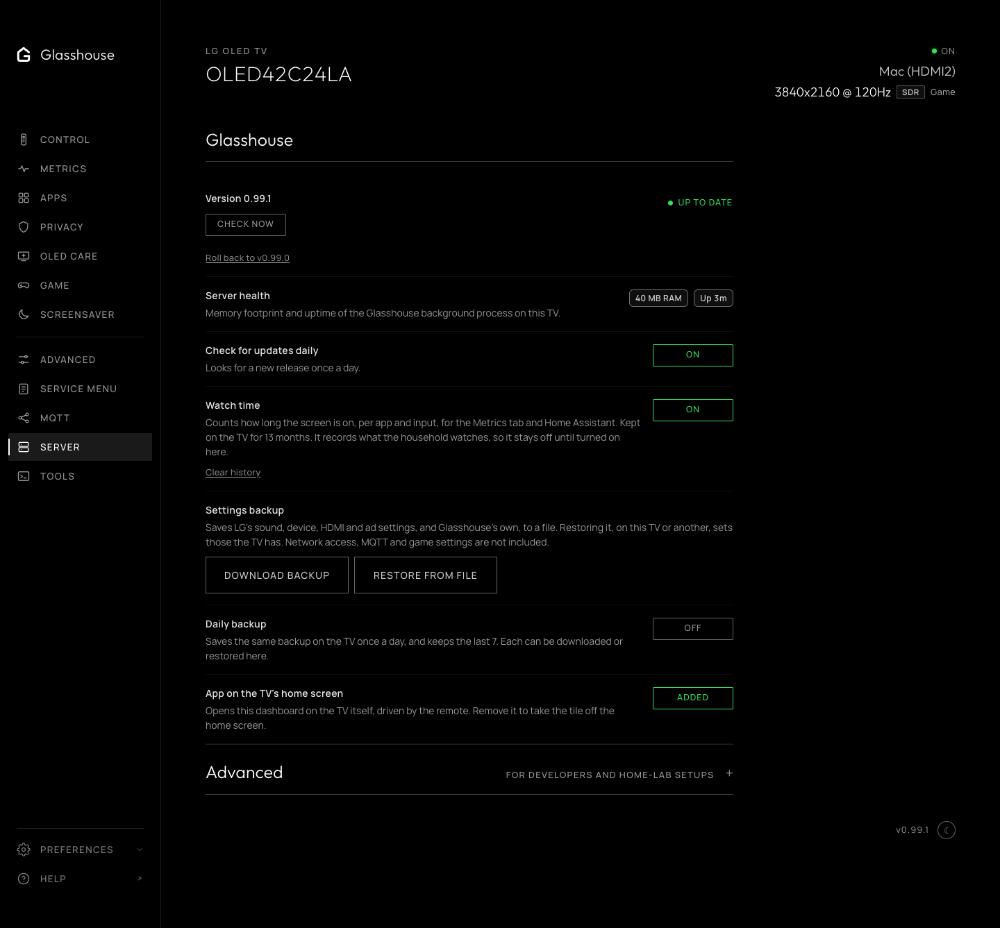

# Server

The **Server** tab, `/?tab=server`, holds Glasshouse's own settings: Glasshouse itself and an Advanced section for developers and home-lab setups. Preferences for this browser (theme, sidebar, and language) are located in the sidebar navigation area.

*Glasshouse's updates and the Advanced section.*

## Glasshouse

Shows the installed version and whether a newer release is out. **Check now** looks straight away, and **Install** appears when there is something to install, with **What's new**: a short summary of what each release since the installed one brings, newest first, and a link to its full notes. **Roll back**, under the version, puts back the version installed before, after asking first. [Updating](../managing.md#updating) covers installs from before the tab existed.

**Check for updates daily** looks once a day on its own, and lets Home Assistant offer the update.

**Server health** shows the background process uptime and memory footprint on the TV.

**Watch time** counts how long the screen is on, per app and input, for [the Metrics tab](metrics.md#watch-time) and Home Assistant. It is off by default, as it records what the household watches. **Clear history** deletes what has been kept, whether counting is on or off.

**Settings backup** saves LG's sound, device, HDMI and ad settings, and Glasshouse's own, to a file, and restores one, on the same TV or another. A restore sets only the settings the TV has and offers, skips those LG greys out at the moment, such as an HDMI input's settings while another input is on screen, and says how many it changed and skipped. Glasshouse restarts if its own settings changed. A backup also lists the apps installed from the Homebrew Channel or by hand. A restore installs none of them itself: those the TV lacks and the Homebrew Channel catalog has are offered on the [Apps tab](apps.md) with **Install all**, each through its usual preview, which stops for a choice such as root, and those not in the catalog are named to install by hand. A backup leaves out what decides who can reach the dashboard (port, host, token, controls), MQTT, whose topic prefix and device id must differ between TVs, the experimental switches, and LG's game settings, which LG keeps per input and genre.

**App on the TV's home screen** adds or removes [the dashboard's own app](../apps/tv-app.md), which opens it on the TV and is driven by the remote.

## Advanced

Folded away, since nothing in it needs changing for everyday use. Once opened, it stays open in that browser.

* **Set the clock from a time server** switches the TV over to [a time server on the local network](../ntp.md), for networks that run one. Switched on, it asks for the server's address. Switched off, the address is kept for next time.
* **Prometheus metrics** turns on the [Prometheus endpoint](../PROMETHEUS.md).
* **Web app debugger** opens or closes Developer Mode's debugger to the network. It is closed unless it is needed, since webOS leaves it open with no password.
* **SSH keys** lists the public keys that can log in as root over SSH, in `/home/root/.ssh/authorized_keys`, by comment, type and SHA256 fingerprint, as `ssh-keygen -l` prints it. A public key pasted in is added, and **Remove** takes one out. While the file is there, the Homebrew Channel leaves root without a password, so only those keys get in. **Delete the key file** stops every key at once, and from the next reboot the Homebrew Channel gives root the password `alpine`, which everyone knows; until that reboot nothing can log in over SSH. The row says which applies now and after the next reboot, and offers **Reboot now** when they differ. None of it applies while SSH is off in the Homebrew Channel.
* **Experimental features**: hiding built-in apps from the Home screen, and custom screen savers on webOS 10 and later. See [Experimental features](../experimental.md) for why they are experimental.
